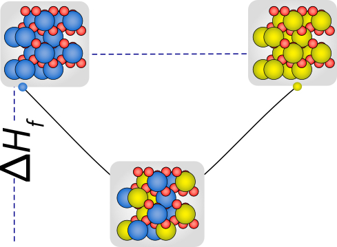

# FEFOS: Formation Energies From Oxidation States

<p align="center"></p>

FEFOS predicts the formation energy of a mixed compound from nothing but the
binary compounds of its elements. Each element's formation energy is described
as a function of its oxidation state, and the compound's energy is the
charge-neutral combination of those curves that minimises the total.

The method was introduced for binary-cation oxides in
[Craig, Kleuker, Bajdich & García-Melchor, *Catal. Sci. Technol.* 2023](https://doi.org/10.1039/D3CY00107E).
**Version 2** is a complete rewrite as a tested Python package and extends the
method from two cations sharing O²⁻ to:

* **any number of cations** (ternary, quaternary, … high-entropy compounds);
* **any anion**: O, S, Se, Te, N, P, C, H, F, Cl, Br, I;
* **any stoichiometry**: e.g. spinels (mean oxidation state 8/3), not just MO, M₂O₃, MO₂;
* **curves fitted automatically** to each element's convex hull, so no hand-tuned coefficients remain.

The code and data exactly as published in 2023 are kept under the git tag
[`paper-2023`](https://github.com/michaelcraiger/fefos/tree/paper-2023), and
`fefos reproduce-paper` recomputes all 2,327 published predictions from the new
code (max. deviation 1×10⁻⁴ eV/atom, the rounding of the published table).

## How it works

1. **One hull per element and anion.** A binary compound M_aX_b sits at the formal
   oxidation state *q* = *v*·*b*/*a* (with *v* the anion valence). Its formation
   energy per cation, *e*(*q*), combines linearly, so the lower convex hull of
   (*q*, *e*) is the thermodynamic hull of the M–X system. Beyond the most
   anion-rich stable compound the hull is flat (excess anion leaves as X₂).
2. **A common reference.** For a compound with cation fractions *cᵢ* and mean
   oxidation state *q̄*, every cation starts at *q̄*. Its reference energy is
   read off its hull, so the 2023 hand-picked or "synthetic" reference oxides
   are no longer needed. This gives the reference average Σ*cᵢ*·Δ*E*(MᵢX_{q̄/v}).
3. **Charge-neutral redistribution (Eq. 2 of the paper, now n cations).** Cations
   shift their oxidation states by *dᵢ*, subject to Σ*cᵢdᵢ* = 0. Each shift is
   priced by that element's oxidation or reduction curve. The minimum is the
   mixing energy ΔD, and Δ*E*_f = reference average + ΔD (Eq. 6).

Three curve and merging modes are provided:

| mode | curves | merging | notes |
|---|---|---|---|
| `linear` (default) | the hull itself (piecewise linear) | concentration-weighted, exact | parameter-free; equals the energy of the most stable mixture of binary compounds (verified against pymatgen to 10⁻¹⁴ eV/atom) |
| `quadratic` | Eq. 1 parabolas *a*₁*x*² + *a*₂*x* least-squares fitted to the hull (per cation, ±2 OS) | concentration-weighted | smooth, two coefficients per side |
| `paper` | Eq. 1 parabolas in the 2023 convention (per atom, symmetric through the minimum) | the 2023 rule: unweighted sum + end-member correction (Eq. 5), generalised to n cations | reproduces e.g. *f*_red,CrO₂ = 0.319*x*² − 0.638*x* of Fig. 1 automatically |

The merging is solved exactly: by bisection on the Lagrange multiplier (the anion
chemical potential) for parabolas, and by a greedy fill of hull segments in
order of slope (a fractional knapsack problem) for the linear mode.

## Results (Materials Project, 2026-09-28 release)

Benchmark: every multi-cation, single-anion compound in MP (lowest-energy
polymorph per composition), 107,600 of 108,808 representable. MAE in eV/atom.

**On the 2023 model's own domain** (two-cation oxides with mean OS 2/3/4, the
2,735 compounds the published coefficients cover):

| | all | ICSD | near hull (<0.1 eV/atom) |
|---|---|---|---|
| FEFOS 2023 (published coefficients) | 0.161 | 0.160 | 0.132 |
| 2023 rule, refitted automatically to the hulls (`paper`) | 0.160 | 0.151 | 0.124 |
| FEFOS v2 `quadratic` | 0.148 | 0.134 | 0.101 |
| FEFOS v2 `linear` | **0.140** | **0.117** | **0.091** |
| reference average (no charge transfer) | 0.212 | 0.255 | 0.192 |

**The extension** (56,428 ionic compounds with metal cations, all twelve anions, 2–6 cations):

| | all | stable | ICSD | near hull |
|---|---|---|---|---|
| `linear` | **0.121** | **0.112** | **0.120** | **0.096** |
| `quadratic` | 0.137 | 0.133 | 0.153 | 0.119 |
| `paper` | 0.160 | 0.167 | 0.167 | 0.146 |
| reference average | 0.234 | 0.242 | 0.276 | 0.234 |

The error does not grow with the number of cations (`linear`: 0.129, 0.115,
0.108, 0.108 eV/atom for 2, 3, 4 and 5+ cations) and is 0.07–0.19 eV/atom across
the twelve anions. Two classes are harder:

* **polyanions and mixed anions**, where a nonmetal acts as a cation (phosphates,
  sulfates, carbonates, oxyhalides): `linear` 0.231 vs reference 0.448;
* **intermetallic-like compounds** with mean OS < 1: 0.55. These are outside
  the oxidation-state picture.

The full validation report with figures is in `docs/validation_report.html`
(download and open it in a browser). Full tables: `results/summary.json`; per-compound predictions:
`results/benchmark_predictions.csv.gz`.

## Assumed bond lengths

The paper pointed to ionic size (tolerance factors, the τ descriptor) as the
next ingredient. `fefos.structure` supplies it without the structure of the
compound being predicted:

* **Reference bond lengths.** Every binary compound within 0.1 eV/atom of the
  hull (2,553 of them) gives the mean cation–anion bond length at the cation's
  charge. Neighbours come from CrystalNN, as in MP, and charges from bond
  valence, so Li is +1 in Li₂O₂. Interpolating in charge gives the **assumed
  bond length** `d(M, X, q)` for 832 element–anion pairs
  (`data/mp_2026-09-28/bond_lengths.csv`).
* **Validated against real structures.** At the oxidation states FEFOS
  predicts, assumed lengths match the actual CrystalNN bond lengths of 118,685
  cation sites in ionic compounds to 0.099 Å (4.0%). That compares with
  0.108 Å when every cation sits at the mean oxidation state, and 0.097 Å with
  the bond-valence charges of the actual structure. FEFOS's composition-only
  charges recover most of that gain.
* **What the hull misses.** The size mismatch and the spread of ionic
  potential *q*/*d* of the cations correlate with the energy FEFOS misses
  (r = −0.30 and −0.27 near the hull): more contrast, more stabilisation. A
  per-anion linear correction (offset plus one slope per descriptor) is fitted
  on near-hull compounds (`bond_correction.csv`):

  | held-out MAE, eV/atom (stable / ICSD) | FEFOS | + anion offset | + offset and bond features |
  |---|---|---|---|
  | chemical systems held out (5-fold) | 0.109 / 0.112 | 0.088 / 0.095 | **0.080 / 0.082** |
  | trained on 2 cations, tested on 3+ | 0.115 / 0.135 | 0.095 / 0.107 | **0.085 / 0.078** |
  | oxide coefficients applied to other anions | 0.096 / 0.092 | **0.076 / 0.075** | 0.089 / 0.080 |

  The coefficients do not transfer between anions, so this is an empirical,
  per-anion term on top of FEFOS, not part of the parameter-free model.

```console
$ fefos predict SrTiO3 KMgF3 Li2ZrN2 --bonds
formula               dEf   +bonds  assumed M-X bond lengths (charge)
SrTiO3             -3.335   -3.453  Sr 2.611 A (+2.00), Ti 1.954 A (+4.00)
KMgF3              -3.460   -3.518  K 2.654 A (+1.00), Mg 1.988 A (+2.00)
Li2ZrN2            -1.122   -1.269  Li 2.045 A (+1.00), Zr 2.275 A (+4.00)
```

## FEFOS against machine learning

`benchmarks/` compares FEFOS with composition-only machine learning on the
same data. That covers Magpie descriptors with gradient boosting (Ward et al.
2016, the baseline of Bartel et al. 2020) and a compact re-implementation of
Roost (Goodall and Lee 2020, the model the 2023 paper compared against). Test
compounds come from 20% of chemical systems never seen in training, and every
model also gets all 3,657 binary compounds, because FEFOS uses them.

| MAE on held-out chemical systems (eV/atom) | 0 | 1,000 | 10,000 | 43,392 (all) |
|---|---|---|---|---|
| FEFOS | **0.117** | 0.117 | 0.117 | 0.117 |
| Magpie + gradient boosting | 0.339 | 0.166 | 0.098 | 0.073 |
| Roost-style network | 0.187 | 0.110 | 0.075 | 0.059 |
| **FEFOS + gradient boosting on its residual** | 0.160 | **0.094** | **0.071** | **0.056** |

The column is the number of multi-cation DFT compounds used for training.

* Given only binaries, the learned models cannot extrapolate to ternaries;
  FEFOS's charge-neutral merge does. Gradient boosting needs about 5,000
  multi-cation compounds to match FEFOS; the Roost-style network has passed
  it by 1,000.
* FEFOS is the best starting point for learning. Gradient boosting on FEFOS's
  residual beats FEFOS from 100 training compounds and ends 23% below gradient
  boosting alone.
* Stability, using the test of Bartel et al., with distance to the hull of
  all other MP phases recomputed self-consistently by `fefos.phase`, because
  MP's published decomposition energies disagree with its formation energies
  for about a quarter of stable compounds: FEFOS alone never predicts a
  compound below the hull, since its prediction is the binary hull. ROC-AUC is
  0.60 with the bond correction, 0.79 for gradient boosting, 0.83 for the
  Roost-style network and 0.85 for FEFOS plus residual learning.
* Speed: 45 µs per prediction in Python, about 3 µs in the JavaScript port in
  the report, with no training.

## Screening for new oxides

`scripts/screen_oxides.py` combines every pair of metal cations at ratios 1:1,
1:2, 2:1, 1:3 and 3:1, with oxygen set by charge balance from common oxidation
states. That gives 15,935 ternary oxides, 13,439 of them not in MP. Each is
scored by its predicted distance to the current MP hull of its A–B–O system,
using FEFOS with the bond correction. Two guardrails apply: FEFOS's oxidation
states must match a charge-balanced assignment, and the bond descriptors must
lie inside the training range. 113 new compositions are predicted at least
0.10 eV/atom below the hull (`results/screening.csv.gz`).

On held-out two-cation oxides, 24% of compounds are stable at random. Of those
FEFOS flags, 45% are stable. Of those the learned second opinion
(`benchmarks/screen_crosscheck.py`) predicts stable, 71% are. When both agree,
90% are stable, from 19 compounds. 16 new compositions pass both. They include:

* **Rb–Ir–O** (Rb₂IrO₃, RbIrO₂, Rb₆Ir₂O₇, Rb₄Ir₂O₅): alkali iridates are an
  OER-catalyst family, and no rubidium member turned up in the literature.
* **Ln₃ReO₈** (Ln = Tb, Dy, Tm, Lu): a fluorite-type family reported
  experimentally but missing from MP, so these are rediscoveries, as is
  Ag₂Mo₄O₁₃, a known photocatalyst, from the FEFOS screen.

The report discusses the catalytic relevance of each family, with sources.

## Install

```bash
git clone https://github.com/michaelcraiger/fefos && cd fefos
pip install -e ".[dev]"      # Python >= 3.10; core needs only numpy and pandas
```

## Use

```console
$ fefos predict SrTiO3 LiFePO4 KMgF3 Li2ZrN2
formula          anion mean OS      dEf      ref       dD  oxidation states
SrTiO3               O    3.00   -3.335   -2.928   -0.407  Sr +2.00, Ti +4.00
LiFePO4              O    2.67   -2.090   -1.676   -0.414  Fe +2.00, Li +1.00, P +5.00
KMgF3                F    1.50   -3.460   -2.938   -0.522  K +1.00, Mg +2.00
Li2ZrN2              N    2.00   -1.122   -0.812   -0.310  Li +1.00, Zr +4.00
$ fefos curves Cr O --q 4 --mode paper     # hull + Eq. 1 parabolas
$ fefos reproduce-paper                    # check against the 2023 predictions
```

```python
from fefos.cli import load_model

model = load_model(mode="linear")          # hulls from data/mp_2026-09-28/binaries.csv
p = model.predict("Ba2YCu3O7")
p.formation_energy, p.reference_energy, p.delta_d, p.oxidation_states

# or from your own binary data (any source: MP, OQMD, your DFT)
from fefos import FEFOS
model = FEFOS.from_binary_entries(
    [{"composition": "TiO2", "formation_energy_per_atom": -3.51}, ...], mode="quadratic"
)
```

## Reproduce the benchmark

```bash
python scripts/fetch_mp.py          # MP summary from AWS Open Data (no API key) -> data/mp_<version>/
python scripts/run_benchmark.py     # -> results/benchmark_predictions.csv.gz, results/summary.json
# assumed bond lengths (pip install -e ".[structure]" for pymatgen)
python scripts/compute_reference_bonds.py   # CrystalNN + bond valence on reference binaries
python scripts/fetch_mp_bonds.py            # MP bond lengths of the benchmark compounds
python scripts/bond_length_analysis.py      # -> bond_lengths.csv, bond_correction.csv, results/bond_lengths.json
# machine-learning comparison and oxide screen (pip install -r benchmarks/requirements.txt)
python benchmarks/features.py
python benchmarks/run_related.py --roost    # -> results/related_work.json
python scripts/screen_oxides.py             # -> results/screening.csv.gz
python benchmarks/screen_calibration.py && python benchmarks/screen_crosscheck.py
python scripts/make_report_data.py          # -> results/report_data.json (collects everything above)
pytest
```

The `quadratic`/`paper` fitting window (±2 oxidation states) was chosen on the
2023 domain only (two-cation oxides) and then applied unchanged to every other
anion and cation count.

## Layout

```
src/fefos/
  composition.py  formula parsing; cation/anion view, mean oxidation state
  hull.py         1-D convex hull of an M–X system on the oxidation-state axis
  curves.py       Eq. 1 parabolas fitted to a hull around any reference state
  mixing.py       charge-neutral merging of curves for n cations (Eqs. 2–5)
  model.py        FEFOS model (linear / quadratic / paper modes)
  structure.py    assumed bond lengths, bond features and the bond-length correction
  phase.py        self-consistent hull energies and decomposition energies (scipy)
  legacy.py       exact 2023 model with the published coefficients
  data.py         Materials Project open-data download and dataset building
  benchmark.py    benchmark runner and metrics
data/
  paper_2023/     published coefficients, references, predictions, benchmark set
  mp_2026-09-28/  binaries.csv (hull inputs), compounds.csv.gz (benchmark targets),
                  binary_bonds.csv, bond_lengths.csv, bond_correction.csv, bonds.csv.gz
benchmarks/       machine-learning baselines (Magpie, Roost-style) and screen cross-checks
results/          benchmark outputs
```

## Citation

```bibtex
@article{craig2023fefos,
  title   = {FEFOS: a method to derive oxide formation energies from oxidation states},
  author  = {Craig, Michael John and Kleuker, Felix and Bajdich, Michal and Garc{\'i}a-Melchor, Max},
  journal = {Catalysis Science \& Technology},
  volume  = {13},
  pages   = {3427},
  year    = {2023},
  doi     = {10.1039/D3CY00107E}
}
```

Materials Project data: A. Jain *et al.*, *APL Materials* **1**, 011002 (2013),
used under CC BY 4.0.
